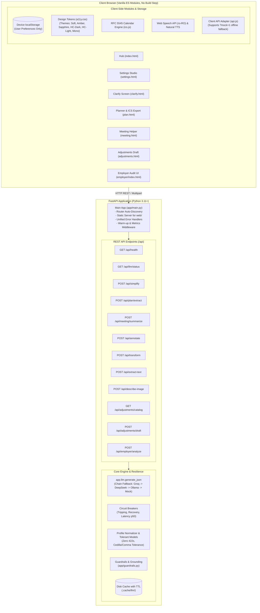

# PrimaZi — System Architecture Document

> **Event:** AccessABILITY Hackathon 2026 — _"First Job, Full Potential: AI for an Inclusive Start at Work"_  
> **Target:** WCAG 2.2 AA / AAA · Responsible AI · European AI Act Workplace Compliance  
> **Repository:** `github.com/ioanstefan2020/Claparii-RDCC`

---

## 1. Architectural Principles & Goals

PrimaZi is built around four non-negotiable architectural tenets:

1. **Accessible by Design (WCAG 2.2 AA / AAA Target):**  
   Accessibility is not an afterthought or visual skin; it is baked into the DOM, keyboard navigation, focus management, high-contrast tokens, screen reader announcements (`aria-live`), and plain-language cognitive formatting.
2. **Responsible AI & Strict Privacy:**
   - **Zero health diagnoses:** We never collect, infer, log, or prompt for clinical diagnoses. Workers articulate needs in their own words.
   - **Score documents, never people:** Employer-facing tools audit document complexity, jargon, and structure; they never evaluate or profile individuals.
   - **No emotion inference:** In accordance with the EU AI Act (Article 5 prohibitions in workplace contexts), voice and video emotion classification is strictly banned. Meeting summarization is text-only.
   - **Verbatim quote grounding:** Every extracted deadline, task, or clarity issue carries a verbatim `source_quote`. Fabricated quotes are stripped by guardrails before reaching the user.
   - **Zero server storage:** User profile preferences live exclusively in device `localStorage`. Documents sent for processing are transient in memory and never logged when `LOG_CONTENT=false`.
3. **Offline-First & Deterministic Mocks:**  
   The application functions 100% reliably with `LLM_PROVIDER=mock` and canned fixtures without external API keys or active internet access, guaranteeing an unbreakable demo and predictable testing.
4. **Contract-First & Modular Disjoint Ownership:**  
   Frontend and backend strictly respect `docs/CONTRACTS.md` and `docs/CONTRACTS-WAVE2.md`. Router auto-discovery allows adding features with zero merge conflicts.

---

## 2. High-Level Architecture Diagram

---

## 3. Wave 2 Reliability, Resilience & Text Intelligence Additions

### 3.1 Multi-Provider Failover Chain & Circuit Breakers (`app/llm/`)

- **Configurable Fallback:** `LLM_PROVIDER_CHAIN=groq,deepseek,ollama,mock`. If primary provider encounters rate limits (HTTP 429), timeouts, or network errors, execution seamlessly falls back to the next configured provider without user-visible failures.
- **Circuit Breaker Pattern:** Each provider is monitored by a stateful circuit breaker (`CLOSED`, `OPEN`, `HALF_OPEN`). When 3 consecutive failures occur, the circuit trips for 60 seconds to prevent cascading delays.
- **Provider Status Transparency:** `GET /api/llm/status` exposes real-time status of each provider, including circuit health, $p50$ latency, and configuration status.
- **Per-Task Routing:** Optional per-task overrides (`LLM_ROUTE_<TASK>`) allow routing latency-sensitive tasks (`transform`, `annotate`) to fast inference engines while directing deep extraction to stronger models.

### 3.2 Tolerant Schemas & Zero HTTP 422 Errors (`app/schemas/profile_norm.py`)

- **`TolerantModel`:** Base Pydantic model with `model_config = ConfigDict(extra="ignore")` across all request/response models.
- **Loose Profile Normalization:** Client preferences (`reading_level`, `format`, `focus_level`, `needs_notes`) are loosely mapped on the server. Synonym mappings and range clamps ensure that client version mismatches never trigger HTTP 422 validation errors.
- **Romanian Diacritics Tolerance:** Handles mixing of cedilla (`ş/ţ`) and comma-below (`ș/ț`) transparently in quote validation and text processing.

### 3.3 Semantic & Deterministic Salience (`POST /api/annotate`)

- **Deterministic Layer:** High-speed regex extraction for dates, times, amounts (RON, EUR, %), document identifiers (`F-12`), and obligations with zero LLM overhead.
- **Semantic Layer:** Extraction of actionable verbs, key roles, warnings, and domain terms.
- **Pragmatic Tone Notes:** Identifies indirect requests (`indirect_request`), Romanian idioms (`figurative`), and polite softeners. Sarcasm and irony are labelled cautiously with `posibilă glumă / ironie — nesigur` and confidence capped at `low`/`medium`, in strict alignment with research findings and EU AI Act boundaries.
- **Density Capping:** Enforces reading science density limits (`light` ≤ 5%, `medium` ≤ 10%, `strong` ≤ 15% of word count).

### 3.4 Multi-Modal Transformation (`POST /api/transform`)

- Supports 7 cognitive presentation modes:
  - List modes: `bullets`, `steps`, `questions`, `glossary`.
  - Prose modes: `shorter`, `tldr`, `easy_read`.
- Grounding preserves all critical facts (deadlines, monetary amounts, and contacts).

### 3.5 In-Memory Document Ingestion (`POST /api/extract-text`)

- Supports PDF, DOCX, TXT, MD, and HTML up to 10 MB entirely in memory without writing temporary files to disk.
- DOCX parsing extracts `word/document.xml` safely without macro execution risks.
- Scanned PDF detection returns `needs_ocr: true` to route users toward image description.

### 3.6 Image & Diagram Accessibility (`POST /api/describe-image`)

- Supports `alt_text`, `read_text`, `chart`, and `document` description modes.
- Integrated with vision providers (Gemini 2.0 Flash) and robust heuristic fallbacks.
- Strictly provides uncertainty notes (`confidence_note`) advising users to verify critical numbers.

---

## 4. Testing & Quality Gate Architecture

Every feature must pass the master automated gate (`scripts/check.sh`) before shipping:

1. **Static Accessibility Gate (`tests/test_a11y_static.py`):** WCAG 2.2 AA / AAA DOM structure and keyboard standards.
2. **Backend Unit & Contract Tests (`tests/backend/`):** Comprehensive unit coverage across all routers, tolerant models, and providers.
3. **Automated Evaluation Harness (`tests/eval/test_wave2_eval.py`):** Golden set scoring schema validity, quote grounding fidelity, prompt injection defense, and latency.
