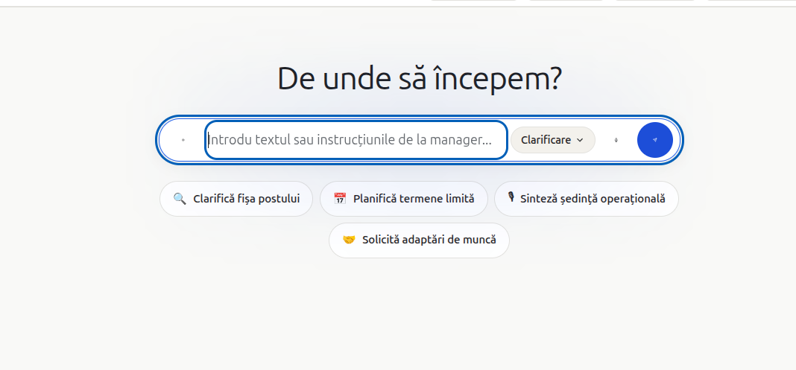 - remove the outline OUT OF every theme when clicking an element as shown in the photo. 
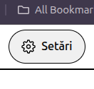 - change the setting picture on the top side to match the settings picture on the navbar at the side.
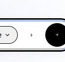 - make the microphone picture larger, you can bearly tell its a microphone
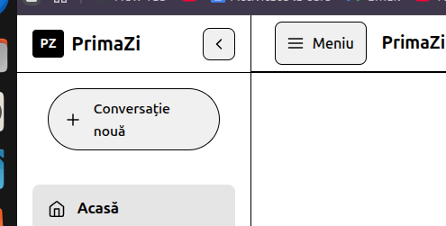 - remove the menu button, its redundant with the navbar slide button
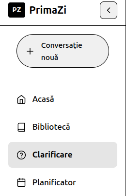 - "conversatie noua" button should point to home page not "clarificare" page
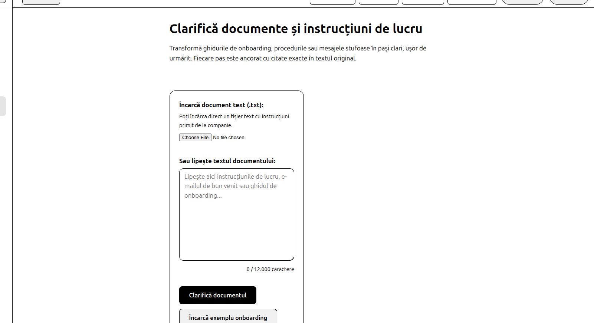 - make the actual text and elements ocupy more of the screen, not around 30% as it is now. Make it "wider"
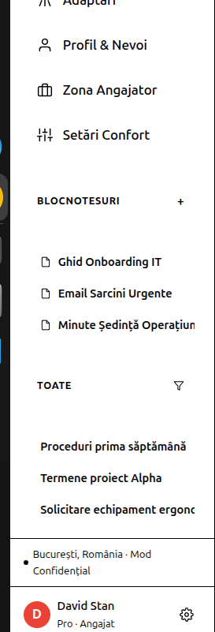 - either remove blocnotes and "toate" or make them work using mock data. also remove David Stan from the footer and put a generic user there.
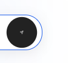 - make the send icon larger, same problem as the microphone icon.
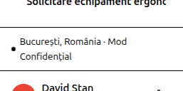 - remove location, or replace it with something else.
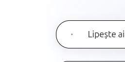 - make the plus icon larger, same problem as the send icon.
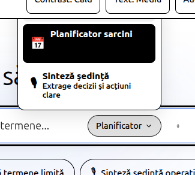 - make the planificarot/clarificare button better, make the actual popup look nicer.
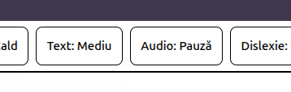 - the audio:pauza button dosent do shit.