# PrimaZi — Prezentare Pitch Deck (6:00 min)

> **Hackathon:** AccessABILITY Hackathon 2026 — *"First Job, Full Potential: AI for an Inclusive Start at Work"*  
> **Format:** 10 Slide-uri · 6:00 minute prezentare + 4:00 minute Q&A juriu.  
> **Echipa Claparii (RDCC):** P1 (AI Core & Backend), P2 (A11y, Preferences Engine & QA), P3 (Design & Employer Hub).

---

## 1. Structura Slide-urilor (Aliniată la cele 13 Criterii ale Juriului)

```mermaid
flowchart LR
    S1["0:00–0:45<br/>S1: Problema & Validarea"] --> S2["0:45–1:15<br/>S2: Soluția Bilaterală"]
    S2 --> S3["1:15–3:45<br/>S3–S5: Live Demo (Ana)"]
    S3 --> S4["3:45–4:15<br/>S6: Accesibilitate WCAG"]
    S4 --> S5["4:15–4:45<br/>S7: AI Responsabil & Etic"]
    S5 --> S6["4:45–5:15<br/>S8: Model B2B & CSRD"]
    S6 --> S7["5:15–5:45<br/>S9: Foaie de Parcurs"]
    S7 --> S8["5:45–6:00<br/>S10: Echipa & Apel Acțiune"]
```

---

### Slide 1: Problema și Nevoia Reală (0:00–0:45)
- **Titlu:** Primul job nu ar trebui să fie un test de anduranță cognitivă.
- **Mesaj cheie:** În România și în UE, 1 din 6 tineri trăiește cu o dizabilitate vizibilă sau invizibilă (neurodivergență, ADHD, hipoacuzie, anxietate). Tranziția de la facultate la primul job eșuează adesea în primele 90 de zile din cauza:
  - Documentelor stufoase de onboarding scrise în limbaj de lemn organizațional.
  - Termenelor limită ambigue primite pe email („cât mai repede”, „până joi”).
  - Fricii de a cere adaptări la locul de muncă de teama stigmatizării sau a concedierii în perioada de probă.
- **Citat de validare:** *„În prima săptămână am primit 40 de pagini de proceduri. Mi-a fost rușine să întreb ce înseamnă F-12 și am lucrat nopțile doar ca să nu par incompetentă.”* (Absolventă IT, diagnostic ADHD).
- **Criterii atinse:** Problem relevance, Impact on people with disabilities, Theme adherence.

---

### Slide 2: Soluția Noastră — Asistentul Bilateral PrimaZi (0:45–1:15)
- **Titlu:** PrimaZi — Adaptăm locul de muncă la persoană, nu invers.
- **Concept:** Prima platformă bilaterală în limba română dedicată incluziunii la primul loc de muncă:
  1. **Latura Angajatului:** Asistent confidențial, device-only, care traduce instrucțiunile complexe în pași concreți, protejează termenele ambigue, extrage acțiuni din ședințe și redactează cereri de adaptare fără divulgarea diagnosticului.
  2. **Latura Angajatorului (HR):** Instrument cognitiv care auditează lizibilitatea ghidurilor interne, elimină jargonul și propune adaptări proactive.
- **Diferențiator major:** Fără conturi pe server, fără colectare de date medicale, fără halucinații — fiecare termen extras are citat verificat în text (`grounding`).
- **Criterii atinse:** Innovation & originality, Meaningful use of AI, Architectural complexity.

---

### Slides 3–5: Demonstrație Live (1:15–3:45)
*(Se derulează conform scriptului detaliat din `docs/DEMO-SCRIPT.md`)*
- **Scena 1: Confort fără etichete medicale** (`/welcome.html`) — Chestionarul cu 7 întrebări și previzualizare în timp real. Stocare 100% locală (`wp.prefs.v1`).
- **Scena 2: Clarificare & Verificare Citate** (`/` Home) — Navigare din tastatură, limbaj simplu, butonul «Arată în text».
- **Scena 3: Planificator & Termene Ambigue** (`/employee/plan.html`) — Interzicerea ghicirii datelor calendaristice, badge `[De confirmat]`, export standard `.ics`.
- **Scena 4: Ședințe fără analiză emoțională** (`/employee/meeting.html`) — Sinteză decizii, asignare sarcini, conformitate cu Directiva Europeană AI Act.
- **Scena 5: Solicitare de Adaptări** (`/employee/adjustments.html`) — Catalog juridic (Legea 448/2006), draft profesional fără dezvăluirea stării de sănătate.
- **Scena 6: Portalul Angajatorului** (`/employer/index.html`) — Scorul de lizibilitate, rescrierea Easy-to-Read, checklist de bune practici.
- **Criterii atinse:** Prototype functionality, Performance & efficiency, UX, Feasibility.

---

### Slide 6: Accesibilitate prin Design — WCAG 2.2 AA & AAA (3:45–4:15)
- **Titlu:** Accesibilitatea nu este o bifă, ci fundamentul arhitecturii.
- **Metrici verificate prin teste automate (`tests/test_a11y_static.py`, `tests/web/prefs/test_tokens.py`):**
  - **100% Keyboard-Navigable:** Zero capcane de tastatură, focus ring vizibil de 3px, linkuri de salt la conținut (`skip-link`) pe fiecare pagină.
  - **Contrast Superior:** Raport contrast text-fundal de 17.7:1 (mod standard) și 19.5:1 (mod contrast ridicat — nivel WCAG AAA).
  - **Scalabilitate Text:** Redimensionare până la 200% fără pierdere de informație și fără scroll orizontal (WCAG 1.4.4 / 1.4.10).
  - **Suport Cititoare de Ecran:** Zone `aria-live="polite"` pentru anunțarea dinamică a rezultatelor, un singur titlu `<h1>` per pagină, etichete explicite pentru fiecare input.
  - **Zero Dependințe Externe:** Fără fonturi Google CDN, fără scripturi externe — securitate deplină și funcționare offline.
- **Criterii atinse:** Accessibility & inclusive design, UX.

---

### Slide 7: Inteligență Artificială Responsabilă & Etică (4:15–4:45)
- **Titlu:** Tehnologie construită pe principii etice riguroase.
- **Piloni de conformitate:**
  1. **Strict Zero Date Medicale:** Nu cerem, nu stocăm și nu deducem niciodată diagnostice sau afecțiuni medicale.
  2. **Interzicerea Clasificării Emoțiilor:** Conformitate strictă cu European AI Act (Articolul 5 — interzicerea AI-ului de recunoaștere a emoțiilor la locul de muncă).
  3. **Ancorare Verificată (Grounding):** Algoritmul `verify_quotes` verifică existența textuală a oricărui citat. Orice halucinație este respinsă automat pe server înainte de a ajunge la utilizator.
  4. **Protecție Anti-Injection:** Textele utilizatorului sunt tratate strict ca date pasive, cu scheme Pydantic rigide (`extra="forbid"`).
  5. **Evaluăm Documente, Niciodată Oameni:** Modulul de HR măsoară claritatea textului corporativ, nu valoarea sau capacitatea candidaților.
- **Criterii atinse:** AI ethics, privacy & safety, Architectural complexity.

---

### Slide 8: Model de Afaceri & Sustenabilitate (4:45–5:15)
- **Titlu:** Gratuit pentru angajați. Sustenabil prin parteneriate B2B și CSR.
- **Modelul economic:**
  - **B2C (Angajați / Tineri cu dizabilități):** 100% Gratuit, permanent.
  - **B2B (Companii & Departamente HR):** Abonament SaaS (licență anuală pe număr de angajați) pentru modulul de audit al documentelor de onboarding și raportare ESG/CSR conform Directivei Europene privind Raportarea de Sustenabilitate Corporativă (CSRD).
  - **Parteneriate Instituționale:** Centre de carieră universitare (UPB, UB, UBB) și agenții județene de ocupare a forței de muncă (ANOFM).
  - **Granturi Europene:** Fonduri destinate incluziunii sociale și digitalizării accesibile (FSE+, Horizon Europe).
- **Criterii atinse:** Scalability & sustainability, Impact.

---

### Slide 9: Foaie de Parcurs & Impact Măsurabil (5:15–5:45)
- **Titlu:** De la hackathon la primul loc de muncă incluziv.
- **Obiective măsurabile pe 12 luni:**
  - **Trimestrul 1 (Pilot):** 10 tineri integrați într-un program pilot alături de un ONG partener și 2 companii IT din București.
  - **Trimestrul 2 (Evaluare & Evaluări A11y):** Set extins de evaluare pe terminologia administrativă românească și audit independent de accesibilitate cu testeri utilizatori de cititoare de ecran.
  - **Trimestrul 3 (Integrare Extinsă):** Integrare prin API securizat cu platforme majore de HR (BambooHR, Workday) pentru pre-verificarea documentelor trimise noilor angajați.
  - **Indicatori Cheie de Performanță (KPIs):** Reducerea timpului de asimilare a procedurilor de onboarding cu 40%, zero cereri de adaptare respinse pe motive procedurale.
- **Criterii atinse:** Feasibility, Impact on people with disabilities.

---

### Slide 10: Echipa și Apel la Acțiune (5:45–6:00)
- **Titlu:** Împreună facem din prima zi un succes garantat.
- **Echipa:**
  - **P1:** Inginerie AI & Sisteme Backend (FastAPI, LLM orchestration, Guardrails).
  - **P2:** Experiență Utilizator & Arhitectură de Accesibilitate (WCAG 2.2, Preferences Engine, QA).
  - **P3:** Strategie Produs, Design & Cercetare Incluzivă (Employer Hub, Validare).
- **Apel la acțiune:** „PrimaZi este funcțional, testat și deschis pe GitHub. Vă invităm să construim împreună un mediu de lucru în care fiecare tânăr își atinge potențialul maxim din prima zi!”
- **Criterii atinse:** Team adherence, Pitch / demo / Q&A.

---

## 2. Cheat Sheet Apărare Q&A cu Juriul (Top 8 Întrebări Strategice)

### Î1: De ce nu folosește un utilizator direct ChatGPT sau Claude?
**Răspuns defensiv verificat:**  
„ChatGPT este un instrument generalist care returnează blocuri de text nestructurate și halucinează frecvent termene limită. PrimaZi oferă 5 garanții pe care ChatGPT nu le poate oferi:
1. **Verificare matematică a citatelor (`verify_quotes`):** Dacă LLM-ul inventează un detaliu care nu există în textul original, serverul îl elimină automat.
2. **Protecția termenelor ambigue:** La expresii precum «cât mai repede», ChatGPT inventează date; PrimaZi blochează generarea calendarului și forțează confirmarea umană.
3. **Export nativ RFC 5545 `.ics`:** Cu un singur click, sarcinile ajung direct în Google Calendar sau Outlook.
4. **Confidențialitate garantată:** Profilul de preferințe trăiește exclusiv în browser (`localStorage`), fără conturi sau baze de date pe server.
5. **Latură bilaterală de angajator:** Un modul dedicat prin care compania își testează lizibilitatea documentelor conform formulelor deterministe din codul nostru.”

### Î2: Cum garantați confidențialitatea și respectarea GDPR pentru datele medicale?
**Răspuns defensiv verificat:**  
„Prin principiul *Privacy-by-Design* absolut: în PrimaZi **nu există niciun câmp de diagnostic sau stare medicală**. Utilizatorul își descrie doar nevoile funcționale de lucru (ex: font mai mare, instrucțiuni scrise, pauze senzoriale). Datele de profil sunt stocate 100% în `localStorage` (`wp.prefs.v1`) pe dispozitivul utilizatorului și nu sunt trimise niciodată la server. Pe server, când `LOG_CONTENT=false` (configurația implicită), documentele sunt procesate exclusiv în memoria volatilă RAM și nu sunt scrise în baze de date sau jurnale de disc.”

### Î3: Cum preveniți halucinațiile pe documente de serviciu critice?
**Răspuns defensiv verificat:**  
„Folosim un strat de protecție algoritmic în `app/guardrails.py`. Fiecare pas extras, fiecare sarcină și fiecare problemă identificată poartă un câmp `source_quote`. Funcția `verify_quotes` normalizează spațiile albe și verifică dacă acel citat este un substring matematic exact în documentul de intrare. Dacă modelul a inventat un citat, elementul este tăiat din răspuns, iar utilizatorul primește o avertizare transparentă în interfață.”

### Î4: De ce ați refuzat explicit detecția emoțiilor din voce sau video?
**Răspuns defensiv verificat:**  
„Din două motive fundamentale:
1. **Legal:** Regulamentul European privind Inteligența Artificială (EU AI Act, Articolul 5) interzice expres utilizarea sistemelor AI de recunoaștere a emoțiilor la locul de muncă și în instituțiile de învățământ.
2. **Accesibilitate:** Persoanele neurodivergente (autism, ADHD) sau cu dizabilități motorii/faciale au un afișaj afectiv non-tipic. Sistemele de clasificare emoțională generează alarme false discriminatorii în cazul lor. Asistentul nostru de ședințe este strict bazat pe text, decizii și acțiuni concrete.”

### Î5: Cine plătește pentru soluție și cum asigurați sustenabilitatea financiară?
**Răspuns defensiv verificat:**  
„Aplicația este permanent gratuită pentru candidați și angajați. Modelul comercial este B2B: vindem licențe anuale companiilor pentru modulul de Resurse Umane. Directiva Europeană CSRD obligă marile companii să raporteze indicatori de incluziune și accesibilitate. Oferim un instrument gata făcut prin care departamentul HR își curăță documentele de onboarding și primește rapoarte de accesibilitate cognitivă. În plus, vizăm parteneriate cu universități pentru centrele de carieră.”

### Î6: Ce ați testat efectiv pe partea de accesibilitate (WCAG) și care sunt limitele actuale?
**Răspuns defensiv verificat:**  
„Am integrat auditul static în pipeline-ul automat `./scripts/check.sh` prin `tests/test_a11y_static.py` și `tests/web/prefs/test_tokens.py`: verificăm atributele de limbă `lang="ro"`, prezența reperelor `<main>`, `<nav>`, `<header>`, linkurile de salt `#main`, contrastul matematic al culorilor (peste 4.5:1 pentru AA și peste 7:1 pentru modurile High-Contrast), țintele tactile de minim 44px și navigarea fără capcane de tastatură.  
*Limitare asumată onest:* Sinteza vocală depinde de vocile românești instalate de sistemul de operare pe browserul utilizatorului, iar analiza documentelor este optimizată momentan pe fișiere text (`.txt` și lipire directă), urmând ca suportul pentru PDF-uri cu layout complex să fie dezvoltat în faza următoare.”

### Î7: Cum este protejat sistemul împotriva atacurilor de tip Prompt Injection?
**Răspuns defensiv verificat:**  
„Documentul încărcat de utilizator este încapsulat rigid ca date pasive, cu delimitatori clari și instrucțiuni de sistem care îi spun modelului să ignore comenzile imperative din text. Ieșirile sunt constrânse prin scheme Pydantic v2 cu `extra="forbid"`. Avem în `app/safety.py` euristici de detecție a frazelor clasice de jailbreak (ex: «ignoră instrucțiunile anterioare»), iar fișierul nostru de test `data/samples/injection_ro.txt` dovedește că modelul extrage doar sarcinile legitime fără a afișa mesajele malițioase sau instrucțiunile interne.”

### Î8: Ce se întâmplă dacă documentul conține un termen vag precum «urgent» sau «cât mai repede»?
**Răspuns defensiv verificat:**  
„Majoritatea asistenților comit eroarea de a pune data de azi sau de mâine în calendar. În contractul nostru API (`docs/CONTRACTS.md §2`), la expresii ambigue modelul returnează obligatoriu `due_iso: null` și `needs_confirmation: true`. În interfață, sarcina primește un marcaj vizual galben «[De confirmat]» și un selector manual de dată. Calendarul final conține doar date asumate conștient de angajat.”

