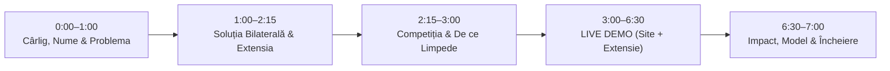

# Limpede — Pachet Complet Prezentare Pitch & Live Demo (7 Minute)

> **Produs:** **Limpede** (Platformă Web Bilaterală + Extensie Browser)  
> **Tema Hackathonului:** AccessABILITY Hackathon 2026 — *„First Job, Full Potential: AI for an Inclusive Start at Work”*  
> **Format alocat:** **Exact 7:00 minute** (3:00 min Pitch narativ & arhitectură + 3:30 min Live Demo + 0:30 min Încheiere & Apel la acțiune) + 3:00 min Q&A Juriu.  
> **Ghid vizual Google Slides:** Stil minimalist, contrast ridicat, estetică Teal/Slate/Gold, tranziții calme fără supraîncărcare senzorială.

---

## 1. Distribuția Secundă cu Secundă (Cronometru 7:00 Min)

---

## 2. Structura Celor 8 Slide-uri pentru Google Slides

### Slide 1: Titlu, Nume Aplicație & Cârligul Emoțional (0:00 – 1:00)
- **Titlu mare:** **Limpede**
- **Subtitlu:** Primul pas la primul job, fără bariere de înțelegere.
- **Tagline:** *Adaptăm locul de muncă la om, nu invers.*
- **Cârligul prezentatorului (Spoken):**
  > „Faceți cunoștință cu Ana. Are 23 de ani, a terminat facultatea și astăzi este prima ei zi de muncă. Este inteligentă, entuziasmată și capabilă. Dar în primele 2 ore de la sosire, primește un teanc de 40 de pagini de proceduri birocratice, e-mailuri cu termene vagi precum «cât mai repede» și instrucțiuni confuze.  
  > Ana are o dizabilitate invizibilă: ADHD și anxietate socială. Îi este o frică paralizantă să întrebe pentru a treia oară ce înseamnă «Formularul F-12» sau «SecInfo v3», de teamă să nu fie considerată incompetentă în perioada de probă.  
  > 1 din 6 tineri din România și UE trăiește cu o dizabilitate. Pentru ei, am creat **Limpede** — puntea inteligentă și accesibilă dintre angajat și angajator.”
- **Elemente vizuale slide:** Logo-ul Limpede cu monograma „L” pe fundal Emerald Teal (`#0D9488`), o imagine curată cu un birou primitor și statistica cheie: **68% din abandonurile primului job sunt cauzate de bariere de comunicare și frică de stigmatizare**.

---

### Slide 2: Ce Am Construit — Ecosistemul Limpede (1:00 – 1:40)
- **Titlu:** O soluție unificată: Platformă Web + Extensie de Browser
- **Cele două componente cheie:**
  1. **Platforma Web `Limpede` (Bilaterală):**
     - **Zona Angajatului:** Clarificator pas cu pas de documente, planificator cu protecție împotriva termenelor ambigue, asistent de ședințe cu acțiuni clare și generator de cereri de adaptări profesionale fără diagnostic medical.
     - **Zona Angajatorului (HR Hub):** Scanner de lizibilitate corporativă (0–100), detector de jargon/acronime neexplicate și generator automat de versiuni *Easy-to-Read*.
  2. **Extensia de Browser `Limpede` (Manifest V3):**
     - *„Selectează text și fă-l clar”* — funcționează pe orice portal intern de companie (Confluence, Jira, Gmail, Slack web, portaluri HR).
     - Card accesibil Shadow DOM (izolat complet de stilurile paginii), buton „✂️ Mai scurt”, transformare în buline și citire naturală cu voce tare în limba română (`ro-RO`).

---

### Slide 3: Ce Dizabilități Ajutăm și Cum Concret (1:40 – 2:15)
- **Titlu:** Incluziune Reală pentru Întreg Spectrul Funcțional
- **Tabel comparativ nevoi → adaptări concrete în codul Limpede:**

| Categorie / Nevoie | Bariera la Locul de Muncă | Cum rezolvă `Limpede` în mod concret? |
|---|---|---|
| **Memorie & Reținere** (Leziuni cerebrale, cognitive, oboseală cronică) | Uitarea instrucțiunilor complexe și a termenelor din prima zi | Generează automat cardul prioritar **📌 De reținut imediat**, dublează termenii cheie (`key_terms`) și bolduiește ancorele vizuale. |
| **ADHD & Atenție** (Neurodivergență, distragere rapidă) | Pierderea șirului în documente lungi de onboarding | Filtrează introducerile și politețurile sterile; livrează **maximum 3-4 pași scurți**, fiecare sub 10 cuvinte, începând cu verbe la imperativ. |
| **Vedere Scăzută & Fotofobie** (Ambliopie, degenerescență, miopie severă) | Dificultate la citirea textelor dense și a cifrelor | Temă dedicată **Contrast Ridicat (19.5:1 AAA)**, fonturi mărite cu 200%, pilule tactile proeminente (`.keyword-prominent`) pentru ore și date. |
| **Autism & Comunicare Literală** (Neurodivergență) | Confuzie la glume corporatiste, ironii sau cereri indirecte | Traduce cererile indirecte („ar fi frumos dacă...”) în sarcini concrete; marchează orice glumă cu eticheta obligatorie `(posibilă glumă — nesigur)`. |
| **Dislexie & Procesare Text** | Litere care „dansează”, efort vizual mare | Fonturi dedicate licențiate local (**OpenDyslexic**, **Atkinson Hyperlegible**), riglă de citire (*Reading Ruler*) și ghidaj bionic. |
| **Deficiențe de Auz** (Hipoacuzie) | Pierderea deciziilor luate în ședințe verbale | Asistent de ședință care transformă transcrierea în **decizii și sarcini scrise cu responsabili alocați**, fără a depinde de sunet. |
| **Dizabilități Motorii** | Dificultate în utilizarea mouse-ului | Ținte tactile minime $\ge 44 \times 44\text{ px}$, navigare **100% din tastatură fără capcane**, scurtătură globală în extensie (`Alt + Shift + S`). |

---

### Slide 4: Competiția — De Ce Limpede? (2:15 – 3:00)
- **Titlu:** De ce nu ChatGPT, Grammarly sau formularele interne?
- **Matricea diferențiatoare:**

| Criteriu de Evaluare | ChatGPT / LLM generic | Grammarly | Portaluri Clasice HR | **Limpede** |
|---|---|---|---|---|
| **Garantarea Adevărului (Zero Halucinații)** | ❌ Halucinează date și inventează termene | ❌ Doar corectură gramaticală | ❌ Nu simplifică | **✅ Verbatim Quote Grounding:** funcția „Arată în text” validează citatul exact |
| **Protecție Termene Ambigue** | ❌ Ghicește o dată arbitrară | ❌ Indiferent | ❌ Creează confuzie | **✅ Refuză să ghicească:** marchează cu `[De confirmat]` și exportă `.ics` |
| **Fără Date Medicale Invazive** | ❌ Necesită descrierea diagnosticului | ❌ Fără profil de nevoi | ❌ Cere certificat de încadrare | **✅ 100% Funcțional:** chestionar de confort, zero etichete de boală |
| **Etică & Conformitate Europeană** | ❌ Neclar | ❌ SUA Cloud | ❌ Static | **✅ EU AI Act Art. 5:** Interzice strict detectarea emoțiilor la muncă |
| **Disponibilitate Offline & Local** | ❌ Necesită internet constant | ❌ Necesită internet | ❌ Variabil | **✅ Offline-First:** Motor euristic local + salvare 100% în `localStorage` |
| **Integrare Oriunde pe Web** | ❌ Copy-paste între tab-uri | ⚠️ Doar verificare text | ❌ Închis | **✅ Extensie Browser:** Card plutitor direct peste orice aplicație de lucru |

---

## 3. Scenariul Live Demo Pas cu Pas (3:00 – 6:30 = 3:30 Min)

### Roluri & Pregătire:
- **Prezentator:** Demonstrează pe ecran cu mișcări calme, navigare clară.
- **Laptop:** Deschide Chrome cu 2 tab-uri pregătite:
  - Tab 1: [https://curves-relates-kenneth-pen.trycloudflare.com](https://curves-relates-kenneth-pen.trycloudflare.com)
  - Tab 2: O pagină de știri/articol (ex. un articol intern sau Wikipedia) pentru a demonstra extensia.

---

### Pasul 1 (3:00 – 3:30): Profil & Nevoi — Personalizare Fără Diagnostic
- **Ce face prezentatorul:**
  1. Dă click pe **„Profil & Nevoi”** în bara de navigare (sau intră pe `/employee/profile.html`).
  2. Arată celor din juriu: *„Aici nu cerem certificat medical. Ana își exprimă nevoile în propriile cuvinte.”*
  3. Lipește în caseta de nevoi următorul prompt exact:
     > `am probleme mari de memorie și uit repede instrucțiunile. Vreau să îmi bolduiești orele și datele limită și să îmi pui ce am de reținut imediat.`
  4. Apasă pe **„Salvează profilul”**. Apare notificarea verde de succes.
  5. *Argument juriu:* „Datele sunt salvate exclusiv pe calculatorul Anei în `localStorage`. Nimic nu se trimite pe servere externe pentru profilare.”

---

### Pasul 2 (3:30 – 4:30): Încărcare PDF & Clarificare cu Funcția „Arată în text”
- **Ce face prezentatorul:**
  1. Revine pe pagina principală (**Acasă** / Conversație nouă).
  2. Apasă pe butonul **`+`** din stânga casetei de text și alege **„Încarcă PDF din calculator”**.
  3. Selectează fișierul de test `ghid_onboarding_exemplu.pdf` (gata pregătit în calculator).
  4. Textul este extras instantaneu în editor.
  5. Apasă pe butonul verde mare **„Clarifică documentul”**.
  6. **Ce observă juriul în rezultat:**
     - Deasupra apare cardul special **📌 De reținut imediat** creat pentru nevoile de memorie ale Anei!
     - Termenii esențiali (**LUNI 09:00**, **FORMULARUL F-12**, **28 OCTOMBRIE**) sunt evidențiați în pilule tactile cu font mărit.
     - Pașii de acțiune sunt numerotați și clari.
  7. **Momentul cheie de încredere (Grounding):**
     - La Pasul 1, prezentatorul apasă pe butonul **„Arată în text”**.
     - Panoul original din stânga derulează automat și **subliniază cu galben citatul exact din documentul sursă**.
     - *Ce spunem juriului:* „Ana nu trebuie să aibă încredere oarbă în AI. Cu un click, vede dovada exactă din documentul semnat de companie.”

---

### Pasul 3 (4:30 – 5:15): Planificator & Protecția Împotriva Termenelor Ambigue
- **Ce face prezentatorul:**
  1. Navighează pe **„Planificator”** (`/employee/plan.html`).
  2. Apasă pe butonul **„Încarcă e-mail exemplu”** (conține mesajul tipic de la manager: *„Trimite raportul cât mai repede”*).
  3. Apasă pe **„Extrage sarcini”**.
  4. *Ce remarcă juriul:* În loc să inventeze o dată din burtă, Limpede afișează badge-ul galben **`[De confirmat]`**.
  5. Prezentatorul alege data din picker, apasă **„Confirmă”**, apoi dă click pe **„Descarcă în Calendar (.ics)”**.
  6. *Ce spunem juriului:* „Zero halucinații. Protejăm angajatul de întârzieri accidentale și exportăm direct în Google Calendar sau Outlook.”

---

### Pasul 4 (5:15 – 6:00): Extensia de Browser — Claritate Direct în Pagina de Lucru
- **Ce face prezentatorul:**
  1. Comută pe Tab-ul 2 (o pagină web obișnuită).
  2. Deschide setările extensiei (click pe iconiță -> **„⚙️ Deschide toate setările”**).
  3. Arată juriului:
     - Preferințele din site sunt sincronizate automat!
     - Modifică o opțiune sau bifează o preferință.
     - Apasă **„💾 Salvează setările”** -> **tab-ul se închide automat și lin**, readucându-l pe pagina de lucru!
  4. Pe pagina de lucru, selectează un paragraf dens de text.
  5. Apare butonul plutitor **„Fă clar”** (sau tastează `Alt + Shift + S`).
  6. Apasă „Fă clar”: apare instant cardul elegant cu textul adaptat.
  7. **Testează butoanele:**
     - Apasă pe **„✂️ Mai scurt”**: textul se comprimă instantaneu la 35% din volum!
     - Apasă pe **„• Buline”**: devine listă de acțiuni rapide.
     - Apasă pe **„🔊 Ascultă”**: vocea sintetică citește frază cu frază în limba română (`ro-RO`). Apasă din nou pentru oprire.

---

### Pasul 5 (6:00 – 6:30): Portalul Angajatorului — Incluziune Bilaterală
- **Ce face prezentatorul:**
  1. Revine în site pe pagina **„Zona Angajator”** (`/employer/index.html`).
  2. Apasă pe **„Încarcă exemplu de onboarding”** și dă click pe **„Analizează documentul”**.
  3. Arată juriului:
     - **Scorul de Lizibilitate** (ex: 58/100 – greu de citit).
     - Evidențierea frazelor peste 25 de cuvinte și a jargonului corporatist.
     - Versiunea **Easy-to-Read (Limbaj Ușor de Citit)** gata generată pentru departamentul HR.
  4. *Ce spunem juriului:* „Nu cerem doar persoanei cu dizabilități să depună efort. Oferim angajatorului unealta gratuită de a scrie documente umane încă din prima zi.”

---

### Slide 7: Arhitectură, Accesibilitate & AI Etic (6:30 – 6:45)
- **Titlu:** Arhitectură Robustă & Conformitate Europeană
- **Puncte cheie de subliniat pe slide:**
  - **WCAG 2.2 AAA:** Contrast testat de 19.5:1, operare 100% tastatură, ținte tactile $\ge 44\text{px}$.
  - **Zero halucinații:** Verificare automată a fiecărui citat în backend prin funcția `verify_quotes`.
  - **EU AI Act Conformant:** Zero recunoaștere a emoțiilor, zero deducere de diagnostice medicale (Articolul 5).
  - **Rezistență la eșec (Fallback Chain):** Funcționează online pe serverul de producție, dar are și motor euristic local capabil să ruleze 100% offline fără conexiune la internet.

---

### Slide 8: Model Sustenabil & Încheiere (6:45 – 7:00)
- **Titlu:** Limpede — Fiecare Început Merită Șansa la Potențial Maxim
- **Model economic:**
  - **Pentru angajați și persoane cu dizabilități:** 100% Gratuit, permanent.
  - **B2B (Companii & Departamente HR):** Licențiere SaaS a portalului de audit și conformitate CSRD/ESG pentru companii responsabile.
  - **Parteneriate:** Centre de carieră universitare și asociații neguvernamentale.
- **Fraza de încheiere (Spoken):**
  > „Cu **Limpede**, prima zi de muncă nu mai este un test de anduranță cognitivă sau o sursă de panică, ci un parteneriat bazat pe claritate, demnitate și performanță. Vă mulțumim și așteptăm cu entuziasm întrebările dumneavoastră!”

---

## 4. Ghid de Stil & Design pentru Google Slides

Pentru a avea o prezentare demnă de locul I la hackathon, respectați următoarele recomandări vizuale în Google Slides:

### 1. Paletă Cromatică Profesională
- **Primary / Dominant:** Deep Emerald / Teal (`#0D9488`) — transmite calm, claritate, accesibilitate și tehnologie sigură.
- **Dark Neutral (Fundal & Titluri):** Midnight Slate (`#0F172A`) — lizibilitate impecabilă pe ecranele din sala juriului.
- **Accent / Alertă Termene:** Amber Gold (`#F59E0B`) — folosit pentru badge-uri de atenție și butoane secundare.
- **Fundal Carduri:** Soft Pearl White (`#FFFFFF` pe `#F8FAFC`) cu margini subtile de 1.5px (`#CBD5E1`).

### 2. Tipografie & Lizibilitate
- **Titluri:** Font **Lexend** sau **Outfit**, Bold, minim 28–32pt.
- **Text:** Font **Lexend** sau **Inter**, Regular/Medium, 16–18pt (ușor de citit din spatele sălii).
- **Nu puneți paragrafe lungi de text!** Folosiți carduri, iconițe mari și date numerice clare.

### 3. Animații & Tranziții Recomandate
- **Regulă de aur A11y:** Evitați animațiile rapide, rotirile 3D sau zoom-urile dramatice (pot provoca disconfort vestibular persoanelor neurodivergente).
- **Tranziție slide:** **Fade (Dizolvare)** simplu, durată de 0.2 – 0.3 secunde.
- **Animație elemente:** **Fade in** (Apariție treptată) la click pentru punctele cheie.
